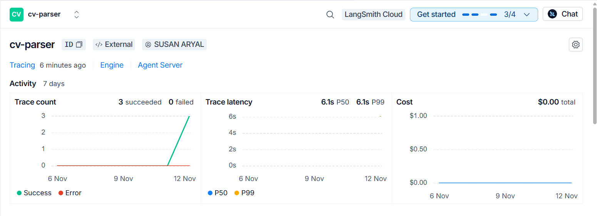
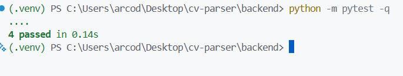

# AI CV Parser

An AI-powered CV parsing application. Upload a CV (PDF or DOCX), and a **LangGraph** pipeline extracts the text, calls a free **OpenRouter** model, repairs invalid output, validates the result, calculates token cost, stores everything in **SQLite**, and sends traces to **LangSmith**.

Built for the _AI Engineer Technical Interview Assignment: AI-Powered CV Parsing System with LangChain / LangGraph_.

## Features

- Upload CVs in **PDF** or **DOCX** format (max 5 MB).
- Structured JSON output: name, LinkedIn URL, phones, emails, address, experience, years of experience, last working company, skills, certifications, languages.
- Missing information is returned as `null` or `[]`. The AI is told never to invent data, and a validator checks this.
- **LangGraph** workflow with 5 nodes, a conditional **repair loop**, and error routes.
- **Prompt management**: view, edit, save (new version), run with the edited prompt, reset to default.
- **Output validation**: valid JSON, required fields, data types, email / phone / LinkedIn format, grounding in the source CV, correct handling of missing data.
- **Cost monitoring**: input and output tokens, cost per CV, total cost, model used, processing duration, model switching.
- **LangSmith** tracing with model and prompt-version tags.
- Next.js UI: upload, model selector, prompt editor, parsed view, JSON, validation status, tokens and cost.

## Architecture

| Node           | Responsibility                                                                                                                                                              |
| -------------- | --------------------------------------------------------------------------------------------------------------------------------------------------------------------------- |
| `extract_text` | PDF (PyMuPDF) or DOCX (python-docx, including tables) to plain text. Fails cleanly on unsupported or scanned files.                                                         |
| `call_llm`     | Calls the OpenRouter model through LangChain `ChatOpenAI`. Records input and output tokens. On a repair attempt, sends the previous answer and the error back to the model. |
| `parse_output` | Finds the JSON object (also strips code fences and extra text), parses it, and checks it against the Pydantic schema.                                                       |
| `validate`     | Runs all validation checks. Computes `years_of_experience` in code.                                                                                                         |
| `persist`      | Calculates cost and duration and saves the run, validation report and result to SQLite.                                                                                     |

**Routing rules**

- After `extract_text`: no text means go straight to `persist` as a failed run.
- After `parse_output`: if there is an error and attempts are left, go back to `call_llm` (repair). If a parsed object exists, go to `validate`. Otherwise go to `persist` as failed.

## Tech stack

| Layer            | Technology                                                  |
| ---------------- | ----------------------------------------------------------- |
| Backend          | Python, FastAPI, Uvicorn                                    |
| AI workflow      | LangGraph, LangChain (`langchain-openai`, `langchain-core`) |
| LLM provider     | OpenRouter (free models)                                    |
| Document parsing | PyMuPDF, python-docx                                        |
| Validation       | Pydantic, `email-validator`, `phonenumbers`, `rapidfuzz`    |
| Observability    | LangSmith                                                   |
| Database         | SQLite                                                      |
| Frontend         | Next.js, React, TypeScript, Tailwind CSS                    |
| Tests            | pytest                                                      |

## Project structure

```
cv-parser/
├── backend/
│   ├── app/
│   │   ├── __init__.py
│   │   ├── config.py        # environment variables
│   │   ├── schemas.py       # Pydantic models (CVData, Experience)
│   │   ├── extractors.py    # PDF / DOCX text extraction
│   │   ├── prompts.py       # default prompt
│   │   ├── db.py            # SQLite: prompt versions and runs
│   │   ├── cost.py          # OpenRouter pricing and cost calculation
│   │   ├── utils.py         # years of experience calculation
│   │   ├── validators.py    # output validation
│   │   ├── graph.py         # LangGraph workflow
│   │   └── main.py          # FastAPI app
│   ├── tests/
│   │   └── test_core.py
│   ├── requirements.txt
│   └── .env.example
├── frontend/                # Next.js app (app/page.tsx is the UI)
├── sample_cvs/              # fictional CVs for testing
├── docs/screenshots/        # screenshots used in this README
├── make_samples.py          # generates the sample DOCX files
├── .gitignore
└── README.md
```

## Setup

### Prerequisites

- Python 3.11 or newer
- Node.js 20 or newer
- An [OpenRouter](https://openrouter.ai) API key
- A [LangSmith](https://smith.langchain.com) API key (for tracing)

### 1. Clone

```bash
git clone https://github.com/arsusan/cv-parser.git
cd cv-parser
```

### 2. Backend

Windows (PowerShell):

```powershell
cd backend
python -m venv .venv
.venv\Scripts\Activate.ps1
pip install -r requirements.txt
copy .env.example .env
```

Open `backend/.env` and fill in your keys (see [Environment variables](#environment-variables)). Then start the API:

```bash
uvicorn app.main:app --reload --port 8000
```

The interactive API docs are at http://localhost:8000/docs.

### 3. Frontend

In a second terminal:

```bash
cd frontend
npm install
```

Create `frontend/.env.local`:

```
NEXT_PUBLIC_API_URL=http://localhost:8000
```

```bash
npm run dev
```

Open http://localhost:3000.

### 4. Sample CVs

The `sample_cvs/` folder contains fictional CVs. To regenerate the DOCX samples (backend venv active, from the repo root):

```bash
python make_samples.py
```

## Environment variables

Defined in `backend/.env.example`. Copy it to `backend/.env`. **Never commit `.env`.**

| Variable             | Required | Description                                                                                                                             |
| -------------------- | -------- | --------------------------------------------------------------------------------------------------------------------------------------- |
| `OPENROUTER_API_KEY` | Yes      | OpenRouter API key                                                                                                                      |
| `DEFAULT_MODEL`      | No       | Default model ID, for example `meta-llama/llama-3.3-70b-instruct:free`. Free model IDs change, so pick a current one from `GET /models` |
| `MAX_RETRIES`        | No       | Extra repair attempts after the first call (default `2`)                                                                                |
| `DB_PATH`            | No       | SQLite file path (default `cvparser.db`)                                                                                                |
| `LANGSMITH_TRACING`  | No       | `true` to enable tracing                                                                                                                |
| `LANGSMITH_API_KEY`  | No       | LangSmith API key                                                                                                                       |
| `LANGSMITH_PROJECT`  | No       | LangSmith project name (for example `cv-parser`)                                                                                        |

## Using the app

1. **Upload** a PDF or DOCX CV.
2. **Choose a model.** Free models are marked `[free]` and listed first.
3. _(Optional)_ **Edit the prompt**, click **Save prompt** (creates a new version), or **Reset to default**.
4. Click **Parse CV**.
5. Read the results:
   - **Validation**: overall status (`valid`, `warnings`, `invalid`, `failed`), each check as PASS or FAIL, and any errors or warnings.
   - **Tokens, cost and time**: model, prompt version, input and output tokens, cost, would-be paid cost, duration, number of LLM attempts, and totals across all runs.
   - **Parsed information** and the raw **JSON output**.

## API reference

| Method | Endpoint        | Description                                        |
| ------ | --------------- | -------------------------------------------------- |
| GET    | `/health`       | Health check and default model                     |
| GET    | `/models`       | OpenRouter models with prices (free models first)  |
| GET    | `/prompt`       | Active prompt: `version`, `text`, `is_default`     |
| PUT    | `/prompt`       | Save a new prompt version. Body: `{"text": "..."}` |
| POST   | `/prompt/reset` | Restore the default prompt as a new active version |
| POST   | `/parse`        | Parse a CV. Form fields: `file`, `model`           |
| GET    | `/runs`         | Last 50 runs                                       |
| GET    | `/stats`        | Total runs, tokens and cost                        |

Example (Windows PowerShell uses `curl.exe`; macOS / Linux use `curl`):

```bash
curl -F "file=@sample_cvs/sample_full.docx" -F "model=YOUR_MODEL_ID" http://localhost:8000/parse
```

Response fields: `run_id`, `status`, `model`, `prompt_version`, `result`, `validation`, `cost`, `duration`, `input_tokens`, `output_tokens`, `attempts`, `error`, `raw_output`.

Error responses: `400` for a wrong file type or empty prompt, `413` for a file over 5 MB, `502` if the model list cannot be loaded.

## Output schema

```json
{
  "name": "string | null",
  "linkedin_url": "string | null",
  "phone_numbers": ["string"],
  "email_addresses": ["string"],
  "address": "string | null",
  "experience": [
    {
      "company": "string | null",
      "title": "string | null",
      "start_date": "YYYY-MM | null",
      "end_date": "YYYY-MM | present | null",
      "description": "string | null"
    }
  ],
  "years_of_experience": "number | null",
  "last_working_company": "string | null",
  "skills": ["string"],
  "certifications": ["string"],
  "languages": ["string"]
}
```

`years_of_experience` is **not** taken from the LLM. The model only extracts dates, and the code merges overlapping jobs and sums the months, because LLMs are unreliable at date arithmetic.

## Output validation

Implemented in `backend/app/validators.py` (plus JSON parsing in the graph). Results are shown in the UI and stored with every run.

| Check                                                                            | How it works                                                                                                                                                            | Failure level                  |
| -------------------------------------------------------------------------------- | ----------------------------------------------------------------------------------------------------------------------------------------------------------------------- | ------------------------------ |
| Valid JSON                                                                       | `parse_output` finds and parses the JSON object. Failure triggers the repair loop.                                                                                      | Retry, then failed run         |
| All expected fields exist                                                        | Every key of the `CVData` schema must be present in the raw response.                                                                                                   | Error                          |
| Correct data types                                                               | Pydantic `CVData.model_validate`. Failure triggers the repair loop.                                                                                                     | Error                          |
| Email format                                                                     | Pydantic `EmailStr`                                                                                                                                                     | Error                          |
| Phone format                                                                     | `phonenumbers` (generic parse, then Nepal region)                                                                                                                       | Error                          |
| LinkedIn URL format                                                              | Regex for `linkedin.com/in`, `/pub`, `/company`                                                                                                                         | Error                          |
| Grounding: emails, phones, LinkedIn                                              | Must appear in the CV text (digits-only match for phones).                                                                                                              | Error (possible hallucination) |
| Grounding: name, address, company, job titles, skills, certifications, languages | Normalized fuzzy match against the CV text (`rapidfuzz`, threshold 85).                                                                                                 | Warning                        |
| Missing data handled                                                             | Placeholder strings such as `N/A`, `unknown`, `none` or empty strings are rejected. Also warns when the CV contains an `@` or `linkedin.com` but nothing was extracted. | Error / warning                |

**Status values:** `valid` (no errors or warnings), `warnings` (only warnings), `invalid` (at least one error), `failed` (no usable output, such as an unreadable file or an LLM failure after all retries).

## Prompt management

- The editable prompt is the **system message**. The CV text is added separately, so editing the prompt cannot break the CV input.
- Prompts live in the `prompts` table with `version`, `text`, `is_active` and `created_at`.
- **Save** creates a new version and makes it active. **Reset** inserts the default prompt as a new version, so history is never lost.
- Every run stores its `prompt_version`, and each LangSmith trace is tagged `prompt:v<N>` with the version in its metadata. This lets you compare prompt versions in LangSmith.

## Cost calculation and monitoring

- Token counts come from the model response (`usage_metadata`) and are summed across retry attempts.
- Prices come from OpenRouter `GET /api/v1/models` (cached for one hour).
- **Cost = input tokens x prompt price + output tokens x completion price.**
- Free models cost `$0`. The app also shows a **would-be paid cost**, calculated with the price of the same model without the `:free` suffix, when OpenRouter lists one. If a model has no paid counterpart in the catalog, the would-be cost is `0`.
- Each run stores model, tokens, cost, would-be cost, and duration. `GET /stats` and the UI show totals across all runs.

## Observability with LangSmith

Set `LANGSMITH_TRACING=true`, `LANGSMITH_API_KEY` and `LANGSMITH_PROJECT` in `backend/.env`, then restart the backend.

Each parse creates a trace named `cv_parse` with:

- every graph node and every LLM request and response,
- token usage and latency,
- tags `cv-parser`, `model:<id>` and `prompt:v<N>`, and metadata (model, prompt version, filename),
- errors, including failed parsing attempts and LLM errors.



## Testing

### Automated unit tests

Run from the `backend` folder:

```bash
python -m pytest -q
```

| Test                                | What it proves                                                                            |
| ----------------------------------- | ----------------------------------------------------------------------------------------- |
| `test_overlapping_jobs_are_merged`  | Two overlapping jobs (2020-01 to 2021-12 and 2021-06 to 2022-12) give 3.0 years, not 3.5. |
| `test_missing_fields_are_invalid`   | A response missing required fields is marked `invalid`.                                   |
| `test_hallucinated_email_is_caught` | An email that is not in the CV text is marked `invalid`.                                  |
| `test_clean_result_passes`          | A correct response with an email present in the CV is marked `valid`.                     |

**Recorded result: 4 passed.**



### End-to-end test cases

Model used for the recorded runs: `baidu/ernie-5.5-flash-preview:free`, prompt version 1.

| ID    | Scenario                                | Steps                                                       | Expected result                                                                                                                             | Result                                                                                              |
| ----- | --------------------------------------- | ----------------------------------------------------------- | ------------------------------------------------------------------------------------------------------------------------------------------- | --------------------------------------------------------------------------------------------------- |
| TC-01 | Complete DOCX CV                        | Parse `sample_cvs/sample_full.docx`                         | Status `valid`. All contact fields extracted. Experience has 2 jobs. Last company is Himal Analytics.                                       | **Passed.** `valid`, 1 attempt, 417 input / 519 output tokens, 4.73 s, cost $0                      |
| TC-02 | Real-world single-person PDF CV (72 KB) | Upload the PDF in the UI and parse                          | Status `valid`. Name, email, phone, LinkedIn and address extracted. `languages` is `[]` because the CV lists none.                          | **Passed.** `valid`, all 5 checks PASS, 1 attempt, 1131 input / 1078 output tokens, 5.32 s, cost $0 |
| TC-03 | CV with missing information             | Parse `sample_cvs/sample_minimal.docx`                      | `phone_numbers: []`, `email_addresses: []`, `linkedin_url: null`, `address: null`, `certifications: []`, `languages: []`. Nothing invented. | Run and record                                                                                      |
| TC-04 | Prompt editing                          | Change the prompt, click Save, then Parse                   | Version number increases. The run reports the new `prompt_version`.                                                                         | Run and record                                                                                      |
| TC-05 | Prompt reset                            | Click Reset to default                                      | Default text restored as a new active version.                                                                                              | Run and record                                                                                      |
| TC-06 | Model switching                         | Parse the same CV with two different models                 | Each run shows its own model, tokens and duration.                                                                                          | Run and record                                                                                      |
| TC-07 | Unsupported file type                   | Upload a `.txt` file through the API                        | HTTP `400`, message `Upload a PDF or DOCX file`.                                                                                            | Run and record                                                                                      |
| TC-08 | File too large                          | Upload a file over 5 MB                                     | HTTP `413`.                                                                                                                                 | Run and record                                                                                      |
| TC-09 | Scanned PDF (image only)                | Upload a PDF with no selectable text                        | Run stored with status `failed` and the error `No text found...`.                                                                           | Run and record                                                                                      |
| TC-10 | LLM failure                             | Use an invalid model ID                                     | Retries up to `MAX_RETRIES`, then status `failed`. The error appears in LangSmith.                                                          | Run and record                                                                                      |
| TC-11 | Hallucinated contact data               | Covered by `test_hallucinated_email_is_caught`              | `invalid` with a "possible hallucination" error.                                                                                            | **Passed** (unit test)                                                                              |
| TC-12 | Years of experience calculation         | Compare `sample_full.docx` output with a manual calculation | See below.                                                                                                                                  | **Passed**                                                                                          |
| TC-13 | Backend offline                         | Stop the backend and reload the UI                          | UI shows `Cannot reach the API. Is the backend running?`                                                                                    | Run and record                                                                                      |

**TC-12 manual check.** For `sample_full.docx` the jobs are Jun 2022 to Dec 2022 (7 months) and Jan 2023 to present (47 months when run in Nov 2026). Total 54 months = **4.5 years**, which matches the application output. Because `present` means today's date, this number grows over time. The unit test uses fixed dates for that reason. For the real PDF CV, Dec 2024 to Aug 2026 is 21 months, which matches the reported 1.8 years.

**LangSmith evidence.** After the first test runs, the `cv-parser` project showed 3 traces succeeded, 0 failed, P50 and P99 latency of 6.1 s, and a total cost of $0.00 (free model).

When you run the remaining cases, replace "Run and record" with the actual outcome.

## Design decisions

- **LangGraph instead of one LLM call.** Separate nodes make each step testable and traceable, and the graph supports a retry loop and error routes cleanly.
- **Repair loop for invalid output.** Free models often return broken JSON or extra text. A tolerant parser plus a retry that sends the error back to the model handles most cases without depending on a provider-specific structured-output mode.
- **Code computes years of experience.** The LLM extracts dates only. Date arithmetic and overlap merging are done in Python.
- **Grounding checks against the source text.** Strong identifiers (email, phone, LinkedIn) are hard errors. Softer fields produce warnings because CVs paraphrase and abbreviate.
- **Prompt is the system message only.** The CV is always passed separately, so a user cannot break the pipeline by editing the prompt.
- **Versioned prompts, never overwritten.** Save and reset both create new versions, which makes runs reproducible and traces comparable.
- **Would-be cost.** Free models always cost 0, so the app also shows what a paid equivalent would cost, to demonstrate cost tracking.

## Known limitations

- **Scanned PDFs are not supported.** There is no OCR. Image-only files fail with a clear error.
- **Free models vary in quality and speed**, and are rate limited. Results can differ between models and between runs.
- **Some free models do not return token usage.** Cost then shows 0.
- **Would-be cost can be 0** when OpenRouter has no paid counterpart for a model ID.
- **Fuzzy grounding is a heuristic.** It can miss a wrong value that looks similar to real text, and it can warn on correct values that were reworded.
- **Multi-column or heavily designed layouts** can reduce extraction quality because text order may be mixed.
- **Certifications and skills are taken as written.** The model may sometimes include an institution name or soft skills in those lists.
- **Single-user, local setup.** There is no authentication or user separation.

## Troubleshooting

| Problem                       | Fix                                                                                     |
| ----------------------------- | --------------------------------------------------------------------------------------- |
| `429` or rate limit errors    | Wait a minute or choose another free model. The graph retries after a short pause.      |
| Model not found (`404`)       | Free model IDs change. Pick a current one from `GET /models`.                           |
| Invalid JSON on every attempt | Try a larger free model. Keep `temperature=0`.                                          |
| `No text found`               | The PDF is a scan. OCR is not supported.                                                |
| CORS error in the browser     | Run the frontend on http://localhost:3000, or add your origin in `backend/app/main.py`. |
| Email validation import error | `pip install "pydantic[email]"`                                                         |
| No traces in LangSmith        | Check the three `LANGSMITH_*` variables and restart the backend after editing `.env`.   |
